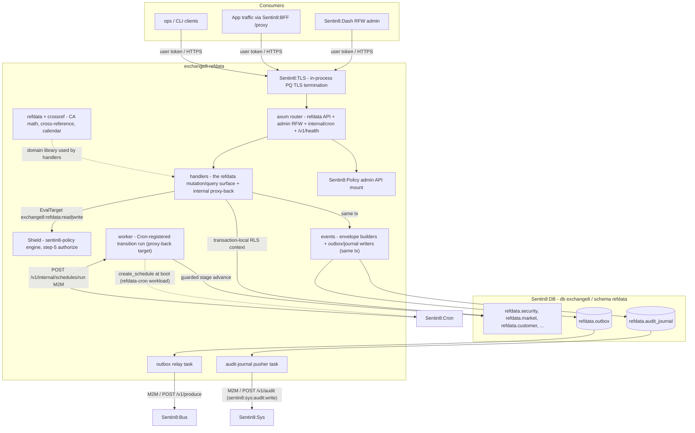

# Exchange8:RefData

## 1. Summary

Exchange8:RefData (`exchange8:refdata`, binary `exchange8-refdata`) is the reference-data
authority of the exchange8 capital-markets vertical: it owns the security master,
markets, MIC venues, currencies, order books, tick rules, market calendars, the
customer/firm directory with sites/contacts/traders, security-identifier
cross-references, and the corporate-action master with its lifecycle
(announced → ex-date → record date → pay-date) and record-date entitlement
model. It is a Rust axum binary booted by the shared Sentin8 Shell, persisting
into schema `refdata` of the vertical database `exchange8`, exposing a
RLS-scoped HTTP API plus a policy-admin surface from Shield.

## 2. Motivation

- Reference data is read on every hot path (matching, routing, market data,
  FX quotes): the security master, scales (`price_scale`/`qty_scale`), lot
  sizes and tick bands must live in exactly one place, under one owner.
- Corporate actions have their own calendar, state machine and position /
  market-data adjustment math - they do not belong in the trade ledger or in
  config tables.
- Every tenant (env) needs its own security universe, customer directory and
  book configuration; PostgreSQL RLS over a globally unique `env_id` gives
  per-env isolation with plain SQL and no shared table grants.
- Sibling services (matching engine, vfeeds, RFQ) must read the security
  master without cross-vertical knowledge - they consume it through declared
  cross-schema SELECT grants and the RLS-scoped query API, never through
  platform tables.
- Admin surfaces must render without shipping UI code: the service exposes
  RFW page definitions that Sentin8:Dash renders.

## 3. Architecture & High-Level Design

The binary is a thin `sentin8::shell` boot (`Sentin8Shell::new("exchange8:refdata",
"EXCHANGE8_REFDATA")`) with `--print-registration` self-registration, a capped
DB pool, in-process post-quantum TLS termination, the Shield policy engine
booted by the shell, and a router extension that adds the securities API plus
admin-alias routes. Domain modules are pure (`refdata.rs` corporate-action
adjustment math, `crossref.rs` identifier cross-reference + CA calendar) and
are covered by in-crate tests independent of HTTP and SQL.

Every request runs the platform 8-step authorization pipeline: bearer verify →
tenant resolve (`env_id` from token claims) → feature gate (shell) → Shield
authorize (`sentin8_policy` - decision, not the JWT `scope` pre-filter) → RLS
context set (`SELECT sentin8_set_tenant_context($1)`, awaited, same
connection/transaction as the query) → execute with an explicit
`WHERE env_id = $1` defense-in-depth → audit (local `refdata.audit_journal`
pushed to Sentin8:Sys).

## 4. Key Traits and Data Structures

- **`SecurityResponse`** - the single projection of a security row served by
  the whole API surface: identity (`id`, `env_id`), naming (`symbol`, `isin`),
  classification (`security_type`, `currency`), market state (`halted`,
  `trading_state`, `shortable`), placement (`market_id`) and precision
  (`price_scale`, `qty_scale`, `min_size`).
- **`ActionType`** - the nine corporate-action kinds
  (`cash_dividend`, `stock_dividend`, `split`, `reverse_split`, `merger`,
  `spin_off`, `rights`, `symbol_change`, `delisting`) with wire keys that map
  onto `refdata.corporate_action.action_type`.
- **`Stage`** - the corporate-action lifecycle enum
  (`Announced → ExDate → RecordDate → PayDate`, terminal at `PayDate`),
  mirrored by the `stage` CHECK constraint on `refdata.corporate_action`.
- **`CorporateAction`** - the ratio-carrying adjustment object
  (`adjust_qty`, `adjust_price`, `cash_per_share`, `cash_entitlement`,
  `stock_entitlement`, `advance`): pure integer math over i128 raw ticks so
  adjustments are value-preserving and exactly reproducible.
- **`CrossRef`** - the (scheme, value) → security resolver over five schemes
  (SYMBOL, ISIN, CUSIP, SEDOL, FIGI); `resolve_any` requires scheme agreement,
  a conflicting mapping resolves to `None` (an ops flag, never a guess).
- **`CaCalendar`** - date-windowed corporate-action calendar
  (`ex_on`, `record_on`, `pay_on`) feeding ex-date adjustment feeds and
  pay-date entitlement settlement feeds.
- **`snapshot_entitlements`** - record-date entitlement projection:
  positions × per-share ratio, filtered to the action's security.
- **`RfwPage` / `RfwSection`** - pure-data RFW page definitions
  (tables + POST-alias actions) rendered by Sentin8:Dash; icons are Material
  Icons code points (hex strings), never names.

## 5. Rationale, Trade-offs, and Alternatives

- **Pattern choices.** Handlers delegate the authorization *decision* to
  Shield (`sentin8::shell::policy::require`) with the JWT `scope` claim only
  as the RLS context feed - a per-handler scope check would fork the
  decision and drift from the admin-visible policy sets. The registration
  ships a `scope-mirror` Shield set (enforced, `origin='platform'`) that
  exactly mirrors the handler gates, so policy evaluation and handler intent
  are the same fact.
- **Multi-scope reads.** Read gates deliberately accept
  `exchange8:order:read` too: order-placing clients read the securities they
  trade against without holding a refdata scope. Writes stay write-gated -
  a reader cannot create securities.
- **Dispatching.** Domain logic is plain enum + struct methods, not trait
  polymorphism: the adjustment rules and resolver are a fixed, closed
  domain; dynamic dispatch would add indirection without a second
  implementation.
- **Concurrency.** One tokio runtime with the axum server plus three
  long-lived background tasks (outbox relay, audit-journal pusher, Shield
  hot-reload consumer). Tenant context is transaction-local
  (`set_config(..., true)`), so nothing global is mutated on the request
  path; the pool is capped (default 3) to protect the shared cluster.
- **Rejected alternatives.**
  - Storing corporate-action money math in floating point - rejected; raw
    i128 ticks keep split/dividend adjustments exact.
  - Broad `{service}:read|write` scopes - rejected; granular
    `exchange8:refdata:{resource}:{action}` scopes keep the surface
    least-privilege.
  - A shared cross-service inbox table for events - rejected; the producer
    path is the service-local `refdata.outbox` + produce API, so no
    horizontal write grants exist.
  - Shipping admin HTML in the service - rejected; RFW JSON definitions
    keep all UI rendering in Sentin8:Dash.

## 6. Internal Implementation & Invariants (Private Design)

**Invariants**

- Every tenant table in schema `refdata` carries `env_id UUID NOT NULL` with
  `ENABLE` + `FORCE ROW LEVEL SECURITY` and the standard policy set
  (`sentin8_context_initialized() AND env_id = sentin8_current_env_id()`).
- The RLS tenant context is set with the awaited `set_tenant_context` helper
  on the SAME connection and transaction as the data query; handlers also
  carry an explicit `WHERE env_id = $1` from the verified claims.
- No secret material is stored in any table - credentials only ever appear
  as secret references; `EXCHANGE8_{SVC}_DATABASE_URL` values travel through
  the vertical registry, not the platform.
- The route table is symmetric for data endpoints:
  `/v1/securities…` (public query API) and `/v1/admin/securities…` (RFW data
  endpoint) are the same handlers with the same gates - and the RFW page
  definitions are served at `/v1/admin/ui/{page}` (the three registration
  routes).
- Outbox rows are written in the same DB transaction as the domain change;
  the shell's relay pushes them to Sentin8:Bus with the outbox row id as the
  produce idempotency key; audit-journal rows are pushed to Sentin8:Sys and
  a Sys outage never drops audit.
- `CrossRef::resolve_any` never invents a resolution: conflicting schemes
  yield `None`, scheme-specific `resolve` stays authoritative.
- The registered scope-mirror Shield set covers every `EvalTarget` the
  handlers evaluate (guarded by the wiring tests) and survives the
  enroll-time dry-run gate.

**Unsafe rationale.** No `unsafe` code exists in this unit; the binary-level
process-wide side effects and both are owned by the Sentin8 Shell.

## 7. Unresolved Questions / Future Designs

- Event consumers downstream (Exchange8:Clearing's ex-date position-adjustment
  projector, the record-date entitlement snapshot) are the consuming
  services' wiring - this service owns the calendar, the events and the
  stage transitions (Sentin8:Cron proxy-back, implemented).
- Mutation surface for the customer/firm master (locations, contacts,
  traders, capitalization) is table-complete but not exposed yet - every
  other refdata table has its API surface.
- A MemBus newest-wins cache for the security master (no per-request
  RLS reads for the matching hot path) - no invalidation channel exists
  yet.
- Crypto corporate actions (forks, airdrops, staking rewards) are deferred
  into the schema's `security_type='Crypto'` + `asset_id` extension only.

---

**Architecture & Design:** exchange8:refdata and its underlying concepts were designed by [Hamid Jahanzad](https://www.linkedin.com/in/hamidjahanzad/).
